# Commissioning Intelligence Platform

A concise B2B executive landing page about turning commissioning experience into reusable engineering products, starting with one measurable pilot. Six continuous sections cover the opportunity, industry problem, product, field advantage, commercial path, and proposed Google Cloud discussion.

## View the complete website

All six sections appear once below, in website order. Click any screenshot for full resolution. No installation is required to view them on GitHub.

### 1. The Opportunity

[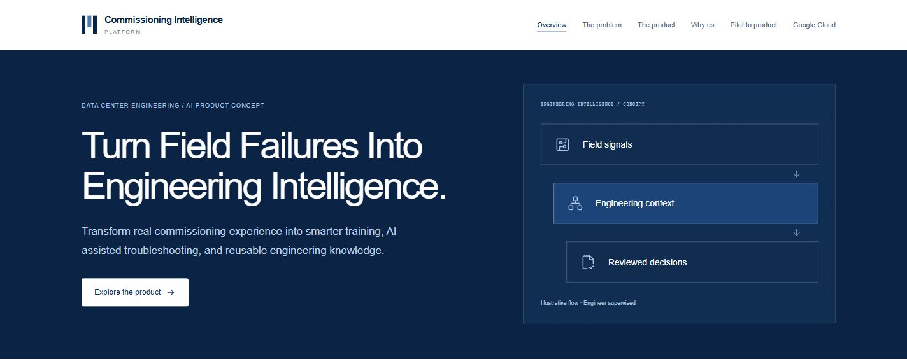](docs/images/landing-01-opportunity.png)

### 2. The Industry Problem

[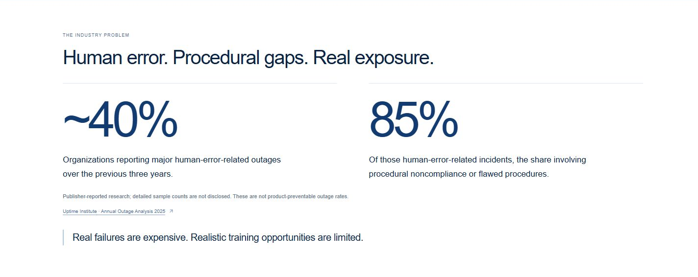](docs/images/landing-02-industry.png)

### 3. The Product

[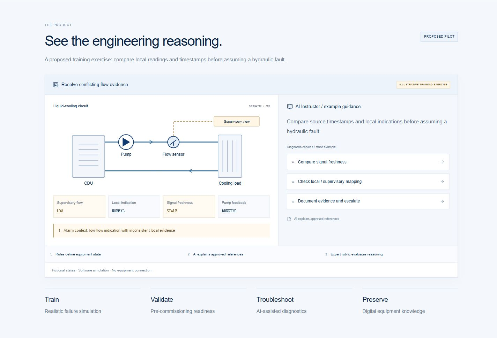](docs/images/landing-03-product.png)

### 4. Why Us

[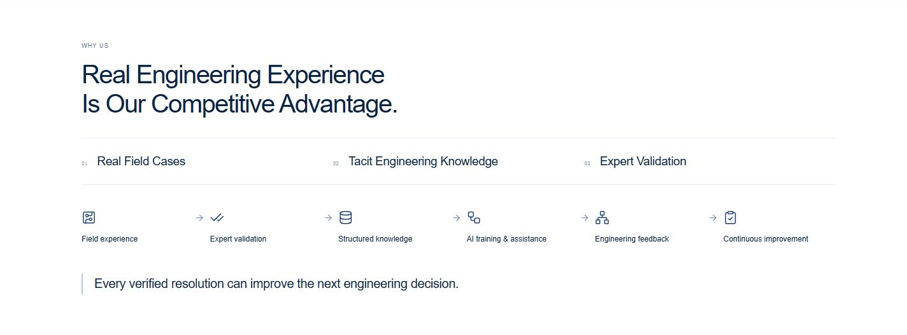](docs/images/landing-04-advantage.png)

### 5. Business Opportunity

[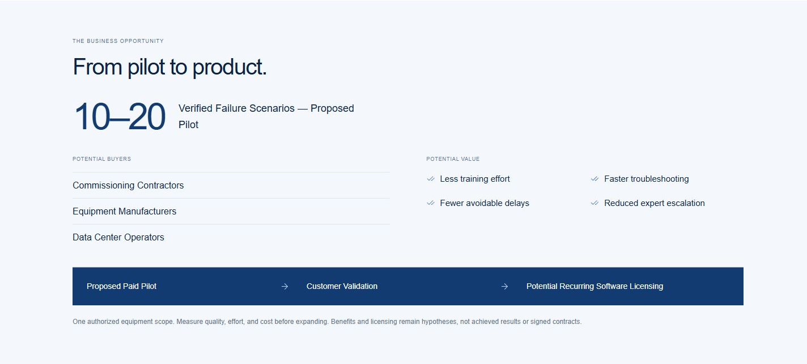](docs/images/landing-05-business.png)

### 6. Google Cloud — Proposed Next Step

[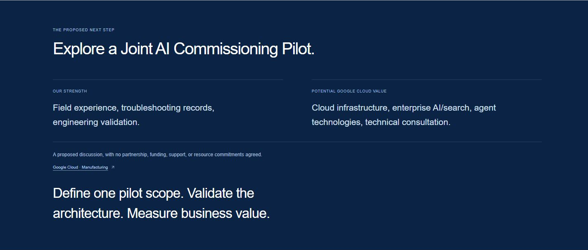](docs/images/landing-06-google-cloud.png)

[Open the complete page as one long screenshot](docs/images/landing-full-page.png).

<details>
<summary>Mobile preview — current version</summary>

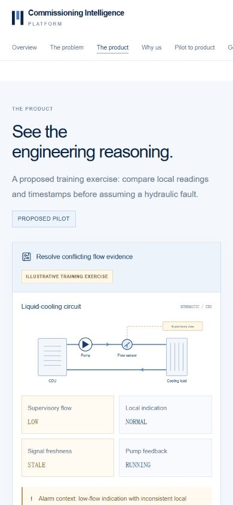

</details>

<details>
<summary>Historical screenshots — earlier versions, retained for reference</summary>

These are previous designs, not the current six-section landing page.

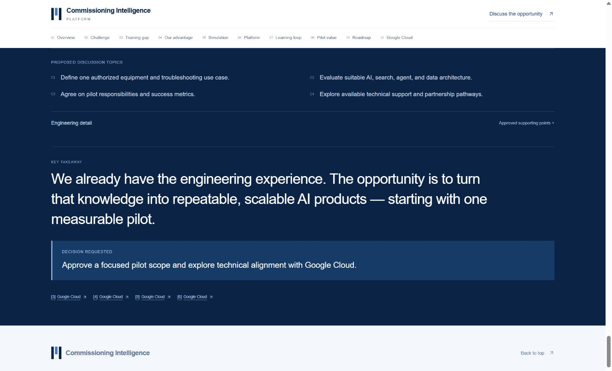

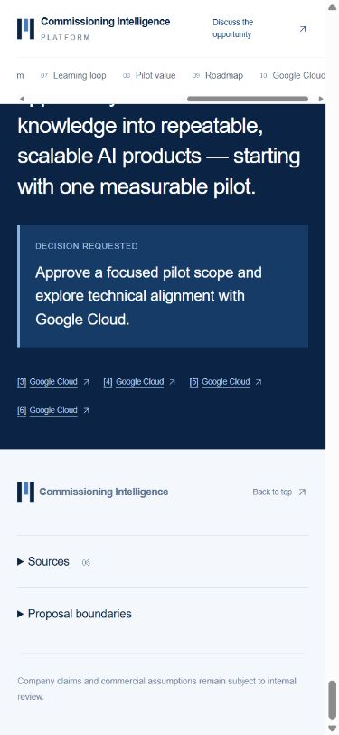

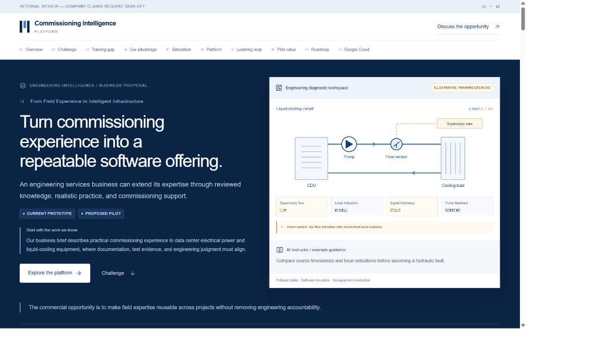

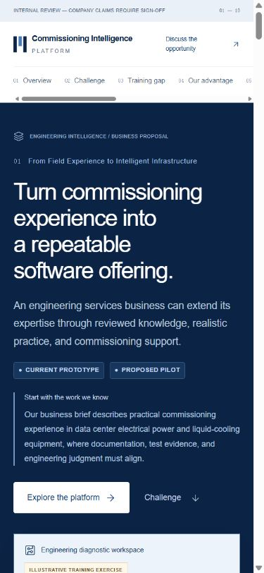

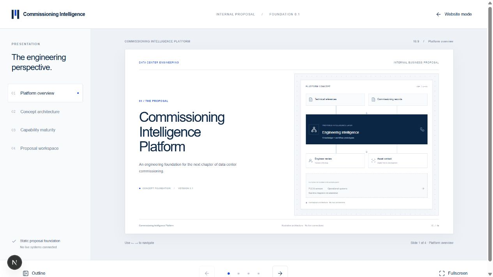

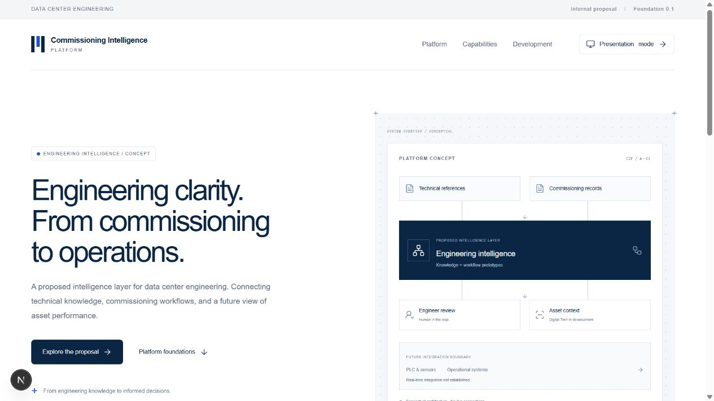

</details>

The website has not been deployed to a public URL. The localhost links below work only on the computer running the development server. GitHub's README displays the screenshots; it does not run the Next.js application.

## Run locally

Use Node.js 24 LTS and npm:

```sh
npm ci
npm run dev
```

Open [the homepage](http://127.0.0.1:3000/) or [the presentation](http://127.0.0.1:3000/presentation/). Both render the same six-section page. Sticky anchor navigation scrolls horizontally on narrow screens. No carousel, slide transitions, page snapping, or live integrations are used.

## Verify and build

```sh
npm run typecheck
npm run build
node --disable-warning=MODULE_TYPELESS_PACKAGE_JSON scripts/verify-presentation.mjs
```

The build script selects the built-in Webpack compiler because the local Turbopack CSS worker failed during final verification. No dependencies were changed.

Static output is exported to `out/`; serve it over HTTP with directory indexes. No production runtime, credentials, database, authentication, external AI calls, or additional dependencies are needed. No deployment has been performed.

The verification script checks both exports for six sections, the 350–550-word budget, anchors, citations, one equipment schematic, and absence of scorecards and internal speaker/methodology text. It also checks preservation hashes for the detailed proposal, references, speaker notes, and content review. The current main-page count is **388 words**, including diagram labels and simulated states, excluding navigation, citations, footer disclosures, and decorative indices.

## Architecture and content

| File | Purpose |
| --- | --- |
| `src/content/landing.ts` | Concise six-section landing copy, separate from the detailed proposal |
| `src/components/presentation/executive-landing.tsx` | Shared server-rendered landing page |
| `src/components/presentation/engineering-diagrams.tsx` | Existing diagnostic workspace and compact engineering loop |
| `src/content/engineering-visuals.ts` | Centralized illustrative diagram labels and simulated states |
| `src/app/landing.css` | Scoped enterprise landing styles and responsive layouts |
| `src/app/page.tsx`, `src/app/presentation/page.tsx` | Homepage and presentation entry points |
| `src/content/presentation.ts` | Preserved ten-section internal proposal, including detailed pilot evaluation |
| `src/content/references.ts` | Eight preserved source records; the landing page cites two relevant sources |
| `docs/speaker-notes.md` | Ten internal speaker narratives, excluded from website imports |
| `docs/content-review.md` | Outstanding business assumptions and company confirmations |
| `docs/archive/landing-preservation.json` | Detailed-content preservation hashes |
| `scripts/verify-presentation.mjs` | Export integrity, word budget, and internal-content exclusion checks |
| `docs/landing-redesign.md` | Current redesign and verification record |

The previous ten-section renderer and historical archives remain in the repository for internal reference. They are not imported by the landing routes. Speaker notes and evaluation methodology are not exposed through public routes or exported assets. Repository access is separate from website access.

## Product and evidence boundaries

The diagnostic workspace is an illustrative proposed training exercise. RAG and Agent workflows remain prototypes; broader Digital Twin capability is under development. Live PLC/sensor integration is not established. Predictive maintenance remains a future vision. Potential benefits, a paid pilot, and recurring licensing are hypotheses requiring validation.

The Uptime statistics retain their respective organization/incident denominators and source attribution; they do not represent preventable outage rates. Google Cloud capabilities describe a possible technical fit, without an existing partnership or resource commitment. Data reuse requires authorization. Read `docs/content-review.md` before external reuse.

## Design and stack

Existing Next.js App Router, TypeScript, React, Tailwind CSS, local shadcn/ui primitives, and Lucide icons. Versions remain pinned in the existing lockfile. Navy, white, and light gray editorial layouts use large statistics, a single equipment workspace, a compact learning loop, and a concise commercialization path.

The [shadcn landing-page reference](https://github.com/nobruf/shadcn-landing-page) informed layout and spacing; its older dependencies were not adopted. No new dependencies were added. The site retains `noindex, nofollow` metadata.

For a PDF, use the browser Print dialog, disable browser headers/footers, and enable background graphics if desired. Print styles are responsive rather than fixed-page slide layouts; review pagination before sharing.
